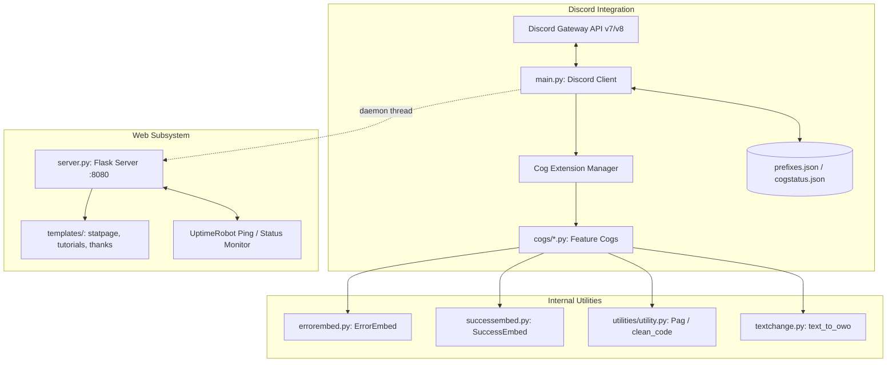

# Ultimate Embed Bot

> [!NOTE]
> **Historical Archive (2020–2021 Era)**  
> This repository is an archived, standalone snapshot of **Ultimate Embed Bot**, an interactive Discord utility bot built during the `discord.py` v1.x era. Active bot development has transitioned to modern asynchronous architectures such as [breed-bot](https://github.com).

---

## Overview

**Ultimate Embed Bot** was created as a multi-purpose Discord bot centered around accessible, rich embed creation without requiring JSON knowledge from users. It provided an interactive in-chat prompt wizard to construct multi-field embeds, host reaction-based community polls, compute color format translations, track server telemetry, and serve lightweight web status endpoints.

---

## Architecture Overview



### Core Subsystems

1. **Bot Engine ([`main.py`](main.py))**:
   * Initializes `discord.ext.commands.Bot` with dynamic server prefix lookup via [`prefixes.json`](prefixes.json).
   * Dynamically discovers and loads all modular cog extensions inside [`cogs/`](cogs/) on startup and synchronizes state to [`cogstatus.json`](cogstatus.json).
   * Exposes administrative developer controls (`eval`, `load`, `unload`, `reload`) guarded by developer ID checks.

2. **Modular Cogs ([`cogs/`](cogs/))**:
   * **Interactive Embed Wizard ([`cogs/embed.py`](cogs/embed.py))**: Step-by-step chat session requesting target channels, titles, descriptions, 9-digit RGB color codes, field definitions, and thumbnail/footer URLs.
   * **Polls & Suggestions ([`cogs/poll.py`](cogs/poll.py))**: Automated reaction-based polling (up to 10 choices with keycap reactions) and binary upvote/downvote suggestions.
   * **Diagnostics & Telemetry ([`cogs/stats.py`](cogs/stats.py))**: Server diagnostics, member counts, Python/discord.py runtime versions, latency checks (`ping`), and uptime links.
   * **Color Calculators ([`cogs/colorcalc.py`](cogs/colorcalc.py), [`cogs/colorlist.py`](cogs/colorlist.py))**: Conversions between RGB component channels and 24-bit decimal color integers accepted by Discord's API.
   * **Moderation & Dev Tools ([`cogs/tools.py`](cogs/tools.py))**: Bulk message purges (`clear`), custom presence modifications, and host console execution (`os`).
   * **Community & Fun ([`cogs/fun.py`](cogs/fun.py), [`cogs/image.py`](cogs/image.py), [`cogs/onthisday.py`](cogs/onthisday.py), [`cogs/minecraft.py`](cogs/minecraft.py))**: Mini-games (`slots`, `colorspin`), external REST API lookups (Minehut, Today in History, JokeAPI), and text manipulation (`owo`).

3. **Background Web Server ([`server.py`](server.py))**:
   * A concurrent Flask micro-server bound to `0.0.0.0:8080`.
   * Serves public status dashboard iframes ([`templates/statpage.html`](templates/statpage.html)), developer tutorial links ([`templates/tutorials.html`](templates/tutorials.html)), and credits ([`templates/thanks.html`](templates/thanks.html)).

4. **Shared Helpers & Utilities**:
   * [`errorembed.py`](errorembed.py) & [`successembed.py`](successembed.py): Factory helpers for uniform visual error and success responses.
   * [`utilities/utility.py`](utilities/utility.py): Custom reaction paginator (`Pag`) leveraging `discord.ext.buttons` and markdown code-block cleaners.
   * [`textchange.py`](textchange.py): String regex and phoneme transformations.

---

## Directory Structure

```
warp/
├── cogs/                       # Modular Discord commands & listeners
│   ├── coglist.py              # Cog manager listing command
│   ├── colorcalc.py            # RGB <-> Decimal conversion calculators
│   ├── colorlist.py            # Built-in color code catalog
│   ├── cooldowns.py            # Server prefix command & feedback logging
│   ├── embed.py                # Multi-step interactive embed creator
│   ├── events.py               # Gateway listeners & cooldown exception handling
│   ├── fun.py                  # Games, jokes, random words, 8ball, owo
│   ├── help.py                 # Dynamic paginated help documentation
│   ├── image.py                # Image & meme command endpoints
│   ├── invite.py               # Bot invite and server invite generator
│   ├── logout.py               # Dev emergency logout and restart hooks
│   ├── minecraft.py            # Minehut server status integration
│   ├── onthisday.py            # Historical events on this day (MuffinLabs API)
│   ├── poll.py                 # Reaction-based poll & suggestion engine
│   ├── stats.py                # Latency, uptime, and guild diagnostics
│   ├── tools.py                # Message purging and developer console
│   └── vote.py                 # Bot voting links
├── templates/                  # Web dashboard HTML templates (Flask)
│   ├── statpage.html           # UptimeRobot status monitoring embed
│   ├── thanks.html             # Project acknowledgements and credits
│   └── tutorials.html          # Reference developer channels and guides
├── utilities/
│   └── utility.py              # Paginator pagination class & string sanitizers
├── .gitignore                  # Git ignore rules for bytecode, secrets, and caches
├── cogstatus.json              # Cog enabled/loaded state registry
├── commands.txt                # Plaintext fallback command catalog
├── errorembed.py               # Uniform red error embed generator
├── index.js                    # Web theme toggle script for frontend templates
├── main.py                     # Primary bot entrypoint & extension orchestrator
├── prefixes.json               # Per-guild command prefix key-value store
├── README.md                   # Project documentation & architecture manual
├── requirements.txt            # Python dependency specification
├── server.py                   # Concurrent Flask web server for health checks
├── successembed.py             # Uniform green success embed generator
└── textchange.py               # OwO text transform phoneme utility
```

---

## Command Reference Summary

| Category | Primary Commands | Description |
| :--- | :--- | :--- |
| **Embeds & Styling** | `embed`, `colors`, `rgbtodecimal`, `decimaltorgb` | Create custom embeds via interactive chat wizard and translate colors. |
| **Community & Polls** | `poll`, `suggest` | Create up to 10-option reaction polls or yes/no community suggestions. |
| **Information** | `help`, `info`, `support`, `cogs`, `stats`, `ping`, `uptime` | Paginated help menu, system status, and latency stats. |
| **Fun & Games** | `joke`, `meme`, `slots`, `word`, `8ball`, `owo`, `lenny`, `colorspin` | Casual games, joke generator, reddit memes, and text transformations. |
| **Integration** | `onthisday`, `minecraftserver`, `invite`, `makeinvite`, `vote` | MuffinLabs history API, Minehut server checker, and invite generation. |
| **Administration** | `prefix`, `feedback`, `clear` | Configure guild command prefixes, send feedback, or purge messages. |
| **Developer Only** | `eval`, `load`, `unload`, `reload`, `logout`, `relog`, `os`, `presence` | Live hot-reloading of extensions, presence updates, and shell execution. |

---

## Historical Context & Era Notes

This repository illustrates several common design patterns of the **2020–2021 Discord bot ecosystem**:

1. **Replit Keep-Alive Pattern**:
   * Running a background Flask thread listening on port 8080 paired with external uptime pings (UptimeRobot) was the standard technique to keep free cloud containers alive 24/7.
2. **Text-Driven Embed Creation**:
   * Built before Discord introduced native UI **Modals** (`discord.ui.Modal`) and **Slash Commands** (`/`). Creating rich embeds required listening to successive messages via `client.wait_for('message')`.
3. **Privileged Intent Migration**:
   * Built for `discord.py` v1.x prior to Discord's restriction of the `Message Content Intent` for message prefix bots.
4. **Modern Successor**:
   * For production Discord bot development with modern UI components (Buttons, Select Menus, Modals), Application/Slash commands, and asynchronous PostgreSQL/Redis persistence, refer to modern projects like **[breed-bot](../breed-bot)**.

---

## Historical Setup (For Reproduction)

### Prerequisites
* Python 3.8
* Discord Bot Token (with Message Content and Server Member intents enabled in the Discord Developer Portal)

### Configuration
Create a `.env` file in the project root:
```env
TOKEN=your_discord_bot_token_here
JOKE-API-KEY=your_rapidapi_joke_api_key_here
```

### Installation & Run
```bash
# Clone the repository
git clone git@github.com:wwwrryyy/warp.git
cd warp

# Install legacy dependencies
pip install -r requirements.txt

# Start the bot and web server
python main.py
```
